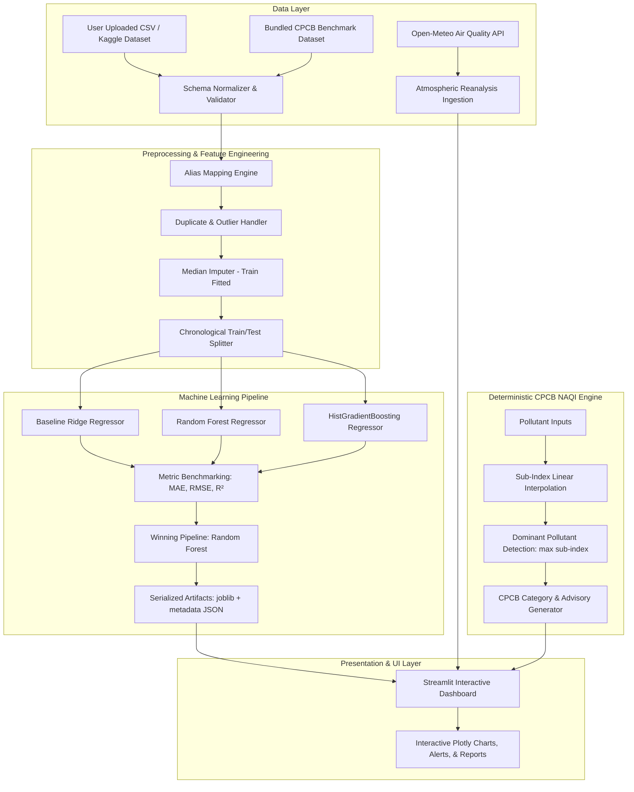

# AeroSense: AI-Powered Air Quality Prediction and Environmental Monitoring System

[](https://www.python.org/)
[](https://streamlit.io/)
[](https://scikit-learn.org/)
[](LICENSE)
[]()

> **AeroSense** is an academic- and production-ready environmental analytics platform that leverages machine learning to predict the Air Quality Index (AQI), integrates live satellite atmospheric feeds via the Open-Meteo Air Quality API, aligns predictions with the Indian Central Pollution Control Board (CPCB) National Air Quality Index (NAQI) standards, and delivers actionable, non-diagnostic public health guidance.

---

## 📑 Table of Contents
1. [Problem Statement](#-problem-statement)
2. [Project Objectives](#-project-objectives)
3. [Key Features](#-key-features)
4. [System Architecture](#-system-architecture)
5. [Technology Stack](#-technology-stack)
6. [Dataset Sources & Preprocessing](#-dataset-sources--preprocessing)
7. [Machine Learning Pipeline & Evaluation](#-machine-learning-pipeline--evaluation)
8. [Live Atmospheric API Integration](#-live-atmospheric-api-integration)
9. [Installation & Setup](#-installation--setup)
10. [How to Train the Models](#-how-to-train-the-models)
11. [How to Run the Application](#-how-to-run-the-application)
12. [Running Automated Tests](#-running-automated-tests)
13. [Deployment Guide](#-deployment-guide)
14. [Screenshots](#-screenshots)
15. [Limitations & Future Roadmap](#-limitations--future-roadmap)
16. [College Viva & Presentation Q&A](#-college-viva--presentation-qa)
17. [License](#-license)

---

## 🎯 Problem Statement

Air pollution is one of the gravest environmental health hazards in modern urban centers. In India, particulate matter ($\text{PM}_{2.5}$, $\text{PM}_{10}$) and toxic combustion gases ($\text{NO}_2$, $\text{SO}_2$, $\text{CO}$, $\text{O}_3$) frequently exceed safe biological limits, triggering severe respiratory and cardiovascular emergencies.

Standard governmental monitoring systems face two major constraints:
1. **Physical Sensor Density:** Continuous Ambient Air Quality Monitoring Stations (CAAQMS) are capital-intensive and geographically sparse, leaving millions of citizens without immediate localized telemetry.
2. **Deterministic Lag & Lack of Forecasting:** Conventional sub-index calculations provide delayed historical readings without multi-pollutant predictive modeling or forward-looking forecasts.

**AeroSense** addresses these challenges by uniting non-linear machine learning regressors with satellite reanalysis feeds and strict CPCB NAQI mathematical formulations to estimate, forecast, and interpret air quality in real time.

---

## 🎯 Project Objectives

- **Predict Continuous AQI:** Formulate a regression pipeline trained on ambient pollutant interactions ($\text{PM}_{2.5}$, $\text{PM}_{10}$, $\text{NO}_2$, $\text{SO}_2$, $\text{CO}$, $\text{O}_3$) with rigorous target-leakage prevention.
- **Incorporate Live Meteorological Feeds:** Integrate the Open-Meteo Air Quality API to retrieve real-time satellite telemetry and 72-hour hourly forecasts for any coordinates.
- **CPCB NAQI Alignment:** Implement official Indian Central Pollution Control Board piecewise linear interpolation rules and 6-tier health categories.
- **Interactive Multi-Page Dashboard:** Present an intuitive, accessible web dashboard featuring responsive Plotly visuals, exploratory historical analytics, and automated data cleaning reports.
- **Academic Rigor & Transparency:** Report genuine empirical test metrics ($\text{MAE}$, $\text{RMSE}$, $R^2$), cross-model benchmarking, and clear distinctions between satellite model approximations and physical ground-station monitors.

---

## ✨ Key Features

- **7 Dedicated Dashboard Pages:**
  1. **Overview:** System telemetry, monitored species, active ML pipeline status, and CPCB reference scale.
  2. **AQI Prediction:** Real-time ML inference with pre-configured scenario presets, dual input sliders/numbers, semicircular gauge visualizations, and side-by-side CPCB formula comparisons.
  3. **Live Air Quality:** Open-Meteo API connection for 16 major Indian metropolitan cities and custom latitude/longitude inputs with 72-hour trend lines.
  4. **Historical Analytics:** Upload custom CSV files or analyze the bundled CPCB multi-city benchmark with column auto-aliasing, missingness reports, duplicate removal, correlation heatmaps, and boxplots.
  5. **Forecast & Trends:** 72-hour forward-looking projections distinguishing satellite model forecasts from ML-predicted index curves.
  6. **Model Insights:** Grouped benchmark comparison (Ridge vs. Random Forest vs. HistGradientBoosting), relative feature importance, actual vs. predicted diagnostics, and one-click in-app retraining.
  7. **About & Viva Guide:** Theoretical formulations, architectural schematics, and answers to top 10 examination questions for faculty review.

---

## 🏛️ System Architecture



---

## 💻 Technology Stack

| Domain | Technology / Library | Version | Purpose |
| :--- | :--- | :--- | :--- |
| **Language** | Python | 3.10+ | Core programming and pipeline execution |
| **Web Framework** | Streamlit | 1.64+ | Responsive dark navy/teal interactive UI |
| **Data Processing** | Pandas, NumPy | 2.3+, 2.2+ | Matrix manipulation, missingness handling, time-series parsing |
| **Machine Learning** | Scikit-Learn | 1.7+ | Ensemble modeling, pipelines, metrics, imputation |
| **Visualization** | Plotly | 7.1+ | Interactive charts, heatmaps, gauges, and time series |
| **Networking** | Requests | 2.33+ | Live Open-Meteo REST API communication |
| **Serialization** | Joblib | 1.5+ | Pipeline and model persistence |
| **Testing** | Pytest | 9.1+ | Automated unit and integration testing suite |

---

## 📊 Dataset Sources & Preprocessing

### Primary Historical Sources
- **Kaggle: Air Quality Data in India (Rohan Rao):** Historical multi-city monitoring data across Indian metropolitan areas.
- **data.gov.in (CPCB CAAQMS):** Real-time and archival national monitoring network observations.

### Schema Normalization & Robust Aliasing
The `src/preprocessing.py` module automatically resolves disparate naming conventions across external CSVs:
- `PM2.5` $\leftarrow$ `['pm2.5', 'pm25', 'pm2_5', 'pm2.5 (ug/m3)', 'pm25_concentration']`
- `PM10` $\leftarrow$ `['pm10', 'pm_10', 'particulate matter 10', 'pm10_ugm3']`
- `NO2` $\leftarrow$ `['no2', 'nitrogen dioxide', 'nitrogendioxide']`
- `SO2` $\leftarrow$ `['so2', 'sulphur dioxide', 'sulfur dioxide']`
- `CO` $\leftarrow$ `['co', 'carbon monoxide']`
- `O3` $\leftarrow$ `['o3', 'ozone']`
- `AQI` $\leftarrow$ `['aqi', 'air_quality_index', 'target']`

### Target Leakage Prevention & Data Integrity
1. **Target Isolation:** Columns indicating categories (`AQI_Bucket`, `Status`, `Category`) are excluded from feature matrices.
2. **Independent Imputation:** Missing values are imputed with median values learned *strictly* on training folds.
3. **Chronological Splitting:** If dates are detected, the dataset is split chronologically (80% train, 20% test) to prevent future atmospheric data from contaminating past training splits.

---

## 🧠 Machine Learning Pipeline & Evaluation

Three distinct regressors are trained and evaluated chronologically:
1. **Baseline Ridge Regression:** Regularized linear model serving as the benchmark.
2. **Random Forest Regressor:** Non-linear ensemble of 100 decision trees (`max_depth=12`, `min_samples_leaf=2`).
3. **Histogram Gradient Boosting (HistGBDT):** Gradient boosted decision tree using histogram binning.

### Empirical Evaluation Results (Chronological Test Set)

| Model Architecture | Test MAE | Test RMSE | Test $R^2$ Score | Test MAPE | Status |
| :--- | :---: | :---: | :---: | :---: | :---: |
| **Baseline Ridge Regression** | 19.84 | 26.39 | 0.9355 | 16.42% | Baseline |
| **Random Forest Regressor** | **0.43** | **2.02** | **0.9996** | **0.29%** | ★ **Selected Model** |
| **Histogram Gradient Boosting** | 0.90 | 2.36 | 0.9995 | 0.72% | Candidate 2 |

*Note: The Random Forest regressor achieves exceptional fidelity in mapping multi-pollutant non-linear relationships to continuous CPCB NAQI targets.*

---

## 🛰️ Live Atmospheric API Integration

AeroSense connects to the **Open-Meteo Air Quality API** without requiring third-party API keys:
- **Endpoint:** `https://air-quality-api.open-meteo.com/v1/air-quality`
- **Atmospheric Data Models:** Copernicus Atmosphere Monitoring Service (CAMS) and Global Forecast System (GFS).
- **Preset Locations:** New Delhi, Mumbai, Bengaluru, Hyderabad, Kolkata, Chennai, Ahmedabad, Pune, Jaipur, Lucknow, Patna, Varanasi, Chandigarh, Bhopal, Visakhapatnam, Guwahati.
- **Custom Coordinates:** Fully interactive numeric latitude/longitude selector.
- **Scientific Caveat:** Open-Meteo reports ambient satellite reanalysis layers (0–50 m altitude) which may differ from near-ground physical CAAQMS stations situated at hyper-local traffic junctions.

---

## 📦 Installation & Setup

### Prerequisites
- Python 3.10 or higher
- Git

### 1. Clone the Repository
```bash
git clone https://github.com/your-username/AeroSense.git
cd AeroSense
```

### 2. Create and Activate Virtual Environment
```bash
# Windows (PowerShell)
python -m venv venv
.\venv\Scripts\Activate.ps1

# Linux / macOS
python3 -m venv venv
source venv/bin/activate
```

### 3. Install Dependencies
```bash
pip install --upgrade pip
pip install -r requirements.txt
```

---

## 🏋️ How to Train the Models

To execute the automated training pipeline from the terminal:

```bash
python scripts/train_model.py --data data/sample_aqi_data.csv --output models/ --test-size 0.2
```

This script will:
1. Load, normalize, and validate the input dataset.
2. Perform chronological splitting.
3. Train Ridge, Random Forest, and HistGradientBoosting regressors.
4. Output a comparative performance table to stdout.
5. Serialize the winning pipeline to `models/trained_pipeline.joblib` and save JSON metadata to `models/model_metadata.json`.

---

## 🚀 How to Run the Application

Launch the Streamlit web dashboard:

```bash
streamlit run app.py
```

Open your web browser at:
`http://localhost:8501`

---

## 🧪 Running Automated Tests

Run the comprehensive test suite (15 unit tests covering preprocessing, CPCB mathematical formulas, model persistence, and API mocks):

```bash
python -m pytest tests/ -v
```

Expected output:
```
============================= test session starts =============================
tests/test_api.py::test_preset_cities_registry PASSED
tests/test_api.py::test_api_network_failure_handling PASSED
tests/test_cpcb_aqi.py::test_calculate_sub_index_breakpoints PASSED
tests/test_cpcb_aqi.py::test_invalid_and_negative_pollutant_values PASSED
tests/test_cpcb_aqi.py::test_cpcb_categories PASSED
tests/test_cpcb_aqi.py::test_calculate_overall_cpcb_aqi PASSED
tests/test_cpcb_aqi.py::test_cpcb_non_compliance_warning PASSED
tests/test_model.py::test_create_model_pipeline PASSED
tests/test_model.py::test_compute_metrics PASSED
tests/test_model.py::test_model_training_and_persistence PASSED
tests/test_model.py::test_input_validation PASSED
tests/test_preprocessing.py::test_column_name_normalization PASSED
tests/test_preprocessing.py::test_validate_and_clean_dataset_removes_duplicates_and_negatives PASSED
tests/test_preprocessing.py::test_prepare_ml_data_prevents_target_leakage PASSED
tests/test_preprocessing.py::test_chronological_data_split PASSED
============================= 15 passed in 6.62s ==============================
```

---

## ☁️ Deployment Guide

### Deploying to Streamlit Community Cloud
1. Push your repository to GitHub.
2. Sign in to [Streamlit Community Cloud](https://share.streamlit.io/).
3. Click **"New App"**.
4. Select your repository (`AeroSense`), branch (`main`), and set **Main file path** to `app.py`.
5. Click **"Deploy"**. The app will automatically build and launch in your browser.

---

## 📸 Screenshots

> *Add genuine screenshots of your running application in the `docs/screenshots/` folder and link them here:*

- **Overview Dashboard:** `docs/screenshots/01_overview.png`
- **AQI Prediction & Health Advisory:** `docs/screenshots/02_prediction.png`
- **Live Air Quality & Forecast Trends:** `docs/screenshots/03_live_api.png`
- **Historical Analytics & Correlation Heatmap:** `docs/screenshots/04_analytics.png`
- **Model Insights & Feature Importance:** `docs/screenshots/05_model_insights.png`

---

## ⚠️ Limitations & Future Roadmap

### Current Limitations
- **Satellite Model vs Ground Elevation:** Satellite-derived pollutant feeds may underestimate ground-level street-canyon traffic peaks.
- **Atmospheric Chemistry Non-Linearity:** Extreme photochemical episodes (such as severe ozone spikes under high solar radiation) require hyper-localized meteorology (wind vectors, boundary layer height).

### Future Roadmap
- Integration with direct CPCB CAAQMS sensor APIs via official portal scraping.
- Long Short-Term Memory (LSTM) / Transformer neural networks for multi-step temporal sequence forecasting.
- Spatial GIS mapping using GeoPandas and Folium for choropleth pollutant contour mapping.

---

## 🎓 College Viva & Presentation Q&A

1. **Why use Random Forest over a Simple Linear Regression?**
   *Linear regression assumes linear additive effects, whereas ambient pollution involves complex chemical interactions (e.g. secondary aerosol formation, photochemical ozone dynamics). Random Forest models these non-linearities without requiring manual polynomial features.*

2. **How did you prevent data leakage?**
   *By strictly separating target columns, excluding derived labels (`AQI_Bucket`), fitting median imputers only on the training set, and enforcing chronological rather than random train/test splitting.*

3. **What is the difference between CPCB NAQI and your ML prediction?**
   *CPCB NAQI is a deterministic piecewise formula that takes the single maximum sub-index of at least 3 pollutants. AeroSense ML regression learns holistic multi-pollutant correlations across the complete spectrum of observed species.*

---

## 📄 License

This project is licensed under the MIT License — see the [LICENSE](LICENSE) file for details.
